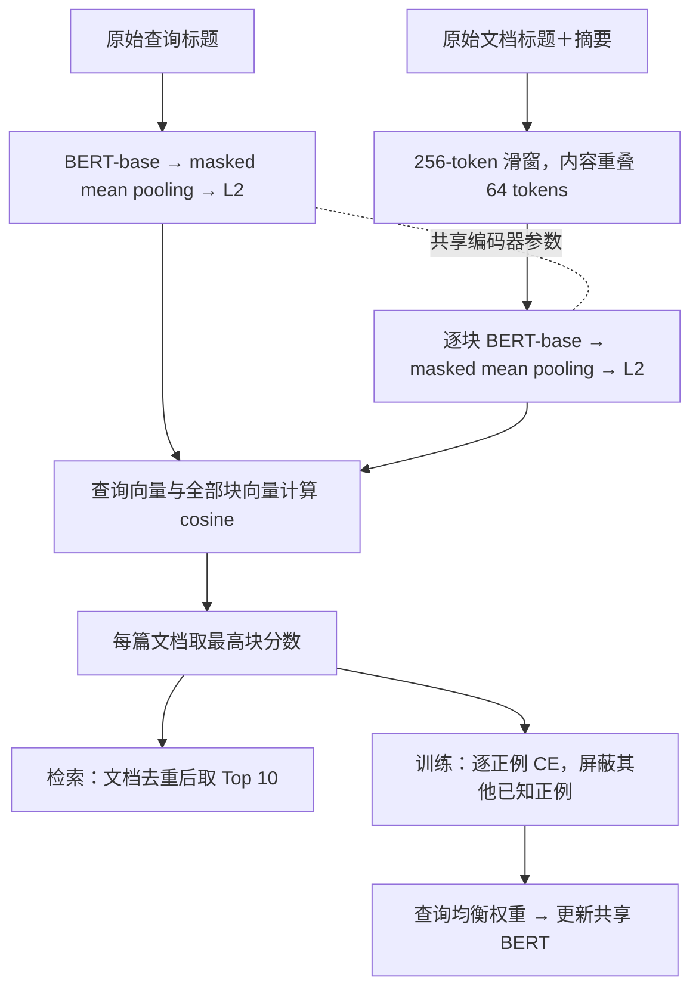

# SBERT：NLI 初始化与 NFCorpus 检索实验记录

记录更新于 **2026-11-04**。文中时间均为北京时间 / UTC+8；原始日志保存 UTC。三个 NFCorpus 检索实验均已完成，原始 NLI 训练主动停止并保留 checkpoint。

本项目从复现 2019 年 SBERT 的 NLI 训练路线开始，随后将目标调整为 **NFCorpus test Recall@10 超过仓库 BM25 基线**。最终原文分块模型达到 Recall@10 **0.160806**，超过相同原始文本口径的 BM25 **0.153696**，相对提升 **4.63%**；nDCG@10 为 **0.327137 vs 0.316185**，相对提升 **3.46%**。这是当前单次实验的观测结果，不代表统计显著或普遍优于 BM25。

## 结果总览

所有 test 实验均在相同的 **3162 篇测试文档、325 条标题查询**上评估，其中 323 条查询有正例，2 条无正例剔除。原始文本与预处理文本必须分别对照，不混用 BM25 基线。下表均为 0–1 数值，保留六位小数；JSON 中保存完整精度。

### 预处理文本：早期实验

| 实验 | 实际训练 / 评估配置 | 评估 checkpoint | Test Recall@10 | Test nDCG@10 |
| --- | --- | --- | ---: | ---: |
| BM25 历史基线 | 完整预处理文档，k1=1.2、b=0.75 | 无训练 | 0.152254 | 0.311744 |
| NLI 早期诊断 | 仅 NLI 分类训练；130 tokens，单向量余弦检索 | NLI step 1000 | 0.018506 | 0.040682 |
| V1：检索微调 | 130 tokens；每查询每轮采 1 个正例，3 epochs、483 steps | 检索 step 400 | 0.124021 | 0.257784 |
| V2：长输入＋全部正例 | 256 tokens；110319 个有效正例对全覆盖，1 epoch、6895 steps | 检索 step 6000 | 0.121456 | 0.282472 |

来源：[BM25](../bm25/results.json)、[NLI step 1000 诊断](evaluations/best-step-000001000-20261030T021835Z/nfcorpus-results.json)、[V1 test](runs/nfcorpus-retrieval/nfcorpus-test-results.json)、[V2 test](runs/nfcorpus-retrieval-256-full/nfcorpus-test-results.json)。NLI step 1000 只是训练早期的额外检索诊断，不是完整训练后的论文复现结果。

### 原始标题与摘要：最终公平对照

| 实验 | Test Recall@10 | Test nDCG@10 |
| --- | ---: | ---: |
| BM25，完整原始标题＋摘要 / 原始查询标题 | 0.153696 | 0.316185 |
| **V3：查询均衡＋逐正例损失＋原文分块** | **0.160806** | **0.327137** |
| 绝对差值 | +0.007111 | +0.010952 |
| 相对提升 | +4.63% | +3.46% |

V3 使用纯向量检索，没有 BM25 分数融合或 Cross-Encoder 重排。BM25 只用于训练难负例挖掘及基线对照。最终导出模型是 **dev Recall@10 选出的 step 6500**，不是最后训练步 6895。

来源：[V3 test 逐查询结果](runs/nfcorpus-recall-raw-chunks/nfcorpus-test-results.json)、[同口径 BM25 test](runs/nfcorpus-recall-raw-chunks/bm25-test.json)、[导出配置与选模信息](runs/nfcorpus-recall-raw-chunks/sentence_transformer/sbert_config.json)。

### Dev 选模记录

| 实验 / 文本口径 | 选模指标 | 最佳 step | Dev Recall@10 | Dev nDCG@10 |
| --- | --- | ---: | ---: | ---: |
| BM25 / 预处理文本 | 无训练 | — | 0.112706 | 0.276846 |
| V1 / 预处理文本 | nDCG@10 | 400 | 0.116374 | 0.253088 |
| V2 / 预处理文本 | nDCG@10 | 6000 | 0.139303 | 0.312272 |
| BM25 / 原始文本 | 无训练 | — | 0.111907 | 0.277347 |
| V3 / 原始文本分块 | **Recall@10** | **6500** | **0.165109** | **0.332062** |

Dev 有 3193 篇文档、325 条查询，324 条参与宏平均，`PLAIN-1730` 无正例而跳过。V2 的 dev Recall 和 nDCG 最优点恰好同为 step 6000，因此仅切换选模指标不会改变 V2 的既有模型。各轮初始 dev、所有评估点和选模过程见对应 run 的 `metrics.jsonl`、`dev-step-*.json`、`status.json`。

## 迭代过程与实际运行时间

| 阶段 | 运行时间（UTC+8） | 核心变化与实际状态 |
| --- | --- | --- |
| NLI 初始化 | 10-29 16:39 启动；10-30 10:59 停止 | BERT-base＋共享双塔 mean pooling，SNLI＋MultiNLI 三分类；计划 58880 步，实际停止于 3372，最佳 STS dev 为 step 3000 |
| V1 | 10-30 11:04–11:54，约 50 分钟 | 从 NLI step 3000 独立开始 NFCorpus 检索微调；130 tokens，查询均匀采样，3 epochs |
| V2 | 10-30 14:58–10-31 06:46，约 15 小时 47 分钟 | 从相同 NLI step 3000 重新开始；256 tokens＋全部正例覆盖，1 epoch |
| V3 | 11-02 11:49–11-04 02:43，约 38 小时 54 分钟 | 从相同 NLI step 3000 重新开始；原文分块、查询均衡权重、逐正例损失，按 dev Recall 选模 |

检索实验耗时根据 `status.json` 的启动与完成时间计算，包含初始 dev、周期 dev、保存及最终 test；不是仅前向 / 反向耗时。三个检索实验均从同一份 NLI 初始化模型出发，**不是 V1 → V2 → V3 连续追加训练**。所有时间为 2026 年。

### 1. 先跑原始 SBERT-NLI 路线

初始目标是复现 SBERT 的 BERT-base / NLI / mean pooling 配方：句对分别经共享 BERT 编码，拼接 `[u; v; abs(u-v)]`，用交叉熵预测 contradiction / entailment / neutral。它通过分类监督间接学习句向量，没有使用 Triplet 或 InfoNCE。

NLI step 1000 的 NFCorpus test Recall@10 仅 0.018506，明显落后于 BM25。这一结果来自早期、未完成的 NLI 模型，且 NLI 并非查询—文档相关性目标，不能作为“完整 SBERT 复现不如 BM25”的结论。

10-29 17:29，在 step 2000 保存时发生 Windows `WinError 5` 目录发布失败；10-30 修复后从有效 step 1500 checkpoint 恢复，回放训练的 loss 与此前一致。修复包括暂时文件锁有限重试、完整 staging 保留、旧快照清理失败只警告，并增加回归测试。故 NLI 的日历跨度包含长时间中断，不能当作连续训练耗时。

按后续实验方向切换，NLI 在 step 3372 正常保存停止。STSbenchmark **dev** 最佳 Spearman 为 **0.626624（step 3000）**；NLI 未跑完 1 epoch，也未产生完整训练结束后的 STS test 结果。后续初始化快照在 `models/nli-step3000-nfcorpus-init`，其来源和文件 hash 由各 run 配置记录。

### 2. V1：将训练目标改为检索

改用 NFCorpus train 的查询—相关文档正例与 BM25 难负例。冻结 NLI 分类头，只训练共享编码器；归一化句向量，用单向 query→document 多正例 InfoNCE，batch 内文档去重，已知相关文档不会作为该查询的负例。

为控制第一次 CPU 实验成本，每轮每个查询组只采 1 个正例与 1 个难负例，3 轮共 7716 次正例呈现，覆盖 **6637 / 110319 个不同有效正例对（6.02%）**。初始 dev nDCG 从 0.022545 提升到最佳 0.253088；test Recall 达 0.124021，但仍低于 BM25 0.152254。

由此确认检索监督确实有效；同时发现输入截断和低正例覆盖是明显限制。130-token 设置会截断 88.3% 的预处理 test 文档；这些限制的实际损失尚未通过单因素消融测定。

### 3. V2：扩大输入并完整覆盖正例

输入提高至 256 tokens，一轮完整遍历 110319 个有效正例对，共 6895 步。Dev 文档超过长度上限的数量从 2825/3193 降到 1056/3193，但文档后部仍可能被截断。

Test nDCG 从 V1 的 0.257784 提高到 0.282472，Recall 却从 0.124021 略降到 0.121456。Dev 最佳 Recall 0.139303 已超过同口径 BM25 0.112706，未能在 test 维持优势，说明不能仅凭 dev 改善或增加训练量保证达到目标。

进一步检查训练目标与宏平均 Recall 的关系：全正例遍历会让正例多的查询占据更多样本；原损失先对正例分数做 `logsumexp`，少数容易正例也能贡献较大的正例概率；单段 mean pooling 还会压缩局部相关证据。这些是下一步设计依据，不是已确认的单项因果解释。

### 4. V3：针对 Recall 的联合改进

联合引入查询均衡权重、逐显式正例损失、原始文本与滑窗分块，同时将选模指标改为 dev Recall@10。完整保留有效正例覆盖，训练文档 3612 篇被编码为 7450 块，单文档最多 13 块；不因块数较多而截掉文档末尾。

| V3 训练 step | Dev Recall@10 | Dev nDCG@10 |
| ---: | ---: | ---: |
| 0 | 0.009997 | 0.022479 |
| 1000 | 0.107226 | 0.247812 |
| 3000 | 0.133809 | 0.285405 |
| 4500 | 0.159849 | 0.327295 |
| **6500（选中）** | **0.165109** | **0.332062** |
| 6895（训练结束） | 0.164985 | 0.331696 |

最终使用 step 6500 的导出模型评估 test，Recall 与 nDCG 均超过相同原始文本的 BM25。未加入 BM25 融合、额外检索模型或 Cross-Encoder。本轮同时改变了文本、分块、loss、权重、dropout 和选模指标，**不是严格消融，无法将提升分配给某一项**。

## 当前模型与损失



BERT-base 为 12 层、hidden size 768、12 个 attention heads。每个查询一个 768 维向量，每个文档块一个 768 维向量；pooling 排除 padding，包含 CLS/SEP。文档可预先编码，查询与文档在向量阶段才交互：

$$
s(q,d)=\max_{c\in\operatorname{chunks}(d)}\cos(f_\theta(q),f_\theta(c)).
$$

这是块级多向量检索 / 后期聚合，不是 ColBERT 的 token 级 MaxSim；没有 Cross-Attention 或可训练的文档级重排层。原 NLI 分类头冻结，不参与检索训练损失，也不导出到最终编码器。

设 $P(q)$ 为该查询全部已知 train 正例，$d^+$ 为当前显式正例，$D_q^-$ 为 batch 内不属于 $P(q)$ 的文档候选。温度 $\tau=0.05$，当前损失为：

$$
\ell(q,d^+)=-\log\frac{\exp(s(q,d^+)/\tau)}{\exp(s(q,d^+)/\tau)+\sum_{d\in D_q^-}\exp(s(q,d)/\tau)},
\qquad w_q=\frac{N}{Q\,|P(q)|},
\qquad L=\frac{1}{B}\sum_{i=1}^{B}w_{q_i}\ell(q_i,d_i^+).
$$

其中 $N=110319$、$Q=2572$；采用固定全局权重，不按每个 batch 的权重和重新归一化，以减弱正例多的查询对训练的支配。正例文档中，最大评分路径对应的块接收梯度，不把文档所有块都强制当成相关块。

## 数据、评估与结果边界

- **标签。** `*.2-1-0.qrel` 为 `query_id 0 doc_id relevance`，中间 `0` 是占位符；末列 2 / 1 分别来自直接 / 间接链接，均视为正例。Train 有 4279 个等级 2、106296 个等级 1 的正例关系；负例是排除已知正例后挖出的 BM25 候选，未标注不等于已确认不相关。
- **划分。** 训练仅使用 train 查询及其标注；dev 用于评估与选模。排除 4 条规范化后与 dev 重复的 train 查询，合并 train 内同文本查询的正例后得到 2572 个查询组、110319 个有效正例对。原始 train 标注总数 110575 与该有效数不可混淆。Train/dev 文档集合本身有重叠，这是本地数据集划分的特征；没有用 dev/test qrels 来构造训练正例或筛选难负例。
- **指标。** Recall@10 先对每条有效查询计算“前十命中数 / 全部正例数”，再宏平均。nDCG@10 使用等级 1/2 的线性增益与 `log2(rank+1)` 折扣。两种模型使用相同 qrels、文档 ID 集合、查询 ID 集合及指标实现；相同分数按文档 ID 升序。
- **文本。** V1/V2 使用数据集提供的去停用词、数字和标点后的文本；V3 使用原始查询标题、文档标题＋摘要，因此重新计算 raw BM25。旧 BM25 Recall 0.152254 仅作历史参考，最终公平对照为 0.153696。
- **局限。** Test 已在多轮迭代中查看，虽然单个 run 在完成后只评估选中模型一次，也不是从未使用过的独立留出测试。当前仅单 seed=42，未做多 seed 或显著性检验；多项改动联合引入，不能声称已完成因果消融或完整复现原论文。当前 3162 篇测试文档口径也不等同于其他 NFCorpus / BEIR 的完整 corpus 设定。

## 结果与代码位置

| 内容 | 路径 |
| --- | --- |
| 最终选优模型 | [runs/nfcorpus-recall-raw-chunks/sentence_transformer](runs/nfcorpus-recall-raw-chunks/sentence_transformer) |
| 完整实验配置、初始模型 hash、数据 hash | [最终 run_config.json](runs/nfcorpus-recall-raw-chunks/run_config.json) |
| 最终状态、选中 step 与最终指标 | [最终 status.json](runs/nfcorpus-recall-raw-chunks/status.json) |
| 所有训练 / dev / test 事件 | [最终 metrics.jsonl](runs/nfcorpus-recall-raw-chunks/metrics.jsonl) |
| V1 / V2 记录 | [V1 run](runs/nfcorpus-retrieval)、[V2 run](runs/nfcorpus-retrieval-256-full) |
| NLI 停止状态与历史错误 | [NLI status](runs/nli-bert-base/status.json)、[WinError 5 记录](runs/nli-bert-base/failure.20261029T092923Z.json) |
| 训练与选模 | [train_retrieval.py](train_retrieval.py) |
| 原始数据映射、难负例及采样 | [retrieval_data.py](retrieval_data.py) |
| 分块、文档评分、逐正例 loss 与梯度缓存 | [chunk_retrieval.py](chunk_retrieval.py) |
| 文档级分块模型评估 | [evaluate_chunk_retrieval.py](evaluate_chunk_retrieval.py) |

环境为 Windows、Xeon Platinum 8370C（8 核 / 16 线程）、64 GiB 内存、CPU 训练（8 Torch 线程），Python 3.12.10、PyTorch 2.6.0+cpu、Transformers 4.51.3。完整依赖见 [requirements-lock.txt](requirements-lock.txt)。`runs/`、`models/`、`data/` 和 `.venv/` 被 Git 忽略；上述本地结果与权重需要另行保存，单独复制 README 不会带上它们。

## 最终实验的运行与复现配置

已完成的最终实验输出 `runs/nfcorpus-recall-raw-chunks`，从本地 NLI 第 3000 步编码器独立开始。结果与完整迭代经过见上文；下列命令保留为复现和运维说明。

1. **查询均衡权重。** 仍完整遍历全部有效正例，每个显式正例行使用 `N / (Q * 该查询正例数)` 的固定权重。N 为有效训练正例总数，Q 为查询组数；batch 内不重新按权重和归一化，目标是均衡查询贡献。
2. **逐正例损失。** 每个训练样本的指定正例单独计算交叉熵，分母包含该正例与负候选，屏蔽该查询其他全部已知正例。不再先汇总所有正例概率后计算一次损失，避免只靠少数容易正例降低损失。等级 1/2 都按正例处理；未知负例仍可能包含漏标相关文档。
3. **原始文本分块。** 按 split 原 ID，从 `raw/doc_dump.txt` 取原始标题与摘要，从 `raw/nfdump.txt` 取原查询标题，保留标点、停用词和数字。文档按 WordPiece token 滑窗，含特殊符号每块最多 256 tokens、重叠 64 个内容 tokens，不限制块数；每个 query-document 分数是所有块余弦相似度的最大值。先合并为文档分数，再排序取前十，同分按文档 ID 升序。

训练在文档级标注上计算最大块评分，不把相关文档的每个块都当成正例。为控制 CPU 内存，采用两遍 embedding 梯度缓存：第一遍无梯度获得全部 chunk 向量，在轻量向量图上计算损失/梯度；第二遍以微批 8 重算编码器并立即反传。两遍均关闭 dropout，编码器参数继续训练。回归验证确认它的梯度与直接保留完整计算图一致。

默认 batch 16、全正例 1 epoch、lr `2e-5`、温度 `0.05`、8 CPU 线程。每 250 步保存，每 500 步及 epoch 末评估完整 dev，**按 dev Recall@10 选模型，相同时保留较早 checkpoint**。最终仅评估选中模型一次 test，不用 test 选择参数。此前 test 已用于多轮实验查看，不能当作从未使用过的独立留出集。

```powershell
.\sbert\start_recall_chunk_training.ps1
Get-Content .\sbert\runs\nfcorpus-recall-raw-chunks\status.json
Get-Content .\sbert\runs\nfcorpus-recall-raw-chunks\chunking_summary.json
Get-Content .\sbert\runs\nfcorpus-recall-raw-chunks\metrics.jsonl -Tail 5
```

已存在已完成的 run 时不要重新覆盖。重新训练应指定新目录，例如 `start_recall_chunk_training.ps1 -OutputDir Q:\repos\ranking_retrieval\sbert\runs\nfcorpus-recall-raw-chunks-repeat`。从零重建本次初始化还需先运行 NLI，取得目标导出；已有初始化模型的 hash 见最终 `run_config.json`。

正常停止在此 run 目录创建 STOP；确认停止后删除 STOP，并用 `start_recall_chunk_training.ps1 -Resume` 恢复。完整 checkpoint 包含优化器、学习率调度器、RNG 与精确批次游标，并核验初始模型、原始文本、train/dev 标注、hard negatives 和采样序列 hash。以前的运行与原参数入口保留。

验证与单独评估：

```powershell
.\sbert\.venv\Scripts\python.exe .\sbert\verify_chunk_training.py
.\sbert\.venv\Scripts\python.exe .\sbert\evaluate_chunk_retrieval.py --split dev --output .\sbert\runs\nfcorpus-recall-raw-chunks\manual-dev-results.json
```

分块模型导出包含 chunk 配置，但 `SentenceTransformer.encode` 只能生成单块向量；文档级 max 聚合必须由 `evaluate_chunk_retrieval.py` 执行。旧单段评估器会拒绝分块模型，避免意外截断。最终 `bm25-test.json` 在相同原始标题/摘要和相同 split 文档/查询 ID 上重新计算；旧预处理文本的 BM25 基线仍保留在 `bm25/results.json`。

## NFCorpus：256 tokens 与全部正例（上一版）

本版从与上一版相同的 NLI 第 3000 步编码器开始，重新初始化优化器，独立输出到 `runs/nfcorpus-retrieval-256-full`。输入总长度从 130 提高到 256 tokens，训练从每轮每查询采一个正例改为每轮覆盖全部有效正例。对 dev 文档统计，超出长度上限的文档从 2825/3193 减少到 1056/3193；超过 256 的部分仍会截断，不使用文档分块。

经过相同的 dev 重复查询排除及 train 重复查询合并后，2572 个查询组包含 110319 个不同正例对。本轮完整遍历一次，batch 16，共 6895 步（6894 个完整 batch，1 个 15 条的 batch）。每个正例对恰好作为显式训练样本出现一次；上一版三轮共覆盖 6637 个不同正例对，约 6%。

采样器为每个查询打乱正例及难负例，以固定随机优先级交错各查询；每批最多取一次同一查询，下一批才允许再次出现。难负例从同一个 BM25 候选池循环选择，全部已知正例继续受到多正例 mask 保护。完整覆盖使正例较多的查询贡献更多训练样本，不再是查询均匀采样。训练配置记录完整采样序列 hash、实际批次数与覆盖计数，支持相同顺序精确恢复。

学习率仍为 `2e-5`、温度 `0.05`、warmup 10%、CPU 8 线程。每 250 步保存、每 500 步及 epoch 末评估 dev，按 dev nDCG@10 选最佳；只有完整结束后才评估 test。此实验同时改变输入长度和训练覆盖，提升或下降不能单独归因于其中一项。

```powershell
.\sbert\start_retrieval_full_training.ps1
Get-Content .\sbert\runs\nfcorpus-retrieval-256-full\status.json
Get-Content .\sbert\runs\nfcorpus-retrieval-256-full\sampling_summary.json
Get-Content .\sbert\runs\nfcorpus-retrieval-256-full\metrics.jsonl -Tail 5
```

停止时在新目录创建 STOP；确认正常退出并移除 STOP 后，用下面命令恢复：

```powershell
.\sbert\start_retrieval_full_training.ps1 -Resume
```

前台等价命令：

```powershell
.\sbert\.venv\Scripts\python.exe .\sbert\train_retrieval.py --output-dir .\sbert\runs\nfcorpus-retrieval-256-full --max-seq-length 256 --sampling all-positives --epochs 1 --save-steps 250 --eval-steps 500
```

默认 `train_retrieval.py` 和旧启动器仍保持旧参数，避免改变已有实验的恢复配置。验证脚本增加全正例无遗漏/无重复、批内唯一查询、偏斜正例数、短 batch、较长 token 上限与导出、完整采样模式的中断恢复一致性检查。

## NFCorpus：130 tokens 的首轮检索微调

新增 `train_retrieval.py`，从本地 NLI 第 3000 步最佳编码器 `models/nli-step3000-nfcorpus-init` 开始，重新创建 AdamW 和调度器。旧 NLI 训练在第 3372 步通过 STOP 正常保存退出，原始实现与 checkpoint 保留。这个新实验使用 NFCorpus 监督相关性训练，不再是 2019 年论文的 NLI 配方。

训练目标为单向 query→document、多正例 InfoNCE：对 batch 中每条查询，将所有已知相关文档的分数放入正例集合，其余候选作为负候选。句向量 L2 归一化，以余弦相似度除以温度 `0.05` 计算损失。NLI 分类头冻结且不参与损失/优化，两个编码分支继续共享 BERT。

- 训练输入只读取 `train.docs`、`train.titles.queries`、`train.2-1-0.qrel`；dev 用同名 dev 文件评估。
- 以小写与折叠空白识别重复查询，排除 4 条与 dev 文本相同的 train 查询，并将 train 内重复查询的已知正例合并。最终有 2572 个训练查询组。
- BM25 从全部 3612 篇 train 文档中为每条查询挖前 20 个非正例候选，排除该查询全部已知正例；不使用 dev/test qrels 来挖负例。未标注文档可能实际相关，不能视为经过人工确认的负例。
- 每个 epoch 打乱查询，每组均匀采 1 个正例及 1 个难负例；batch 内文档按 ID 去重，同一查询全部已知正例均纳入正例 mask。默认 3 epochs、batch 16，共 483 步，采样 7716 个查询—正例事件，不声称穷举所有 110575 个训练相关对。
- 使用现有预处理文本和总长度 130 tokens，以便先观察训练目标变化；本轮没有引入原始文本恢复、文档分块、融合或重排。长文档截断限制仍存在。
- 开始训练前先记录初始模型和 BM25 的 dev 指标；每 100 步及 epoch 末评估完整 dev，按线性增益 nDCG@10 选最佳。完整训练结束后，选中的模型仅评估一次 test，结果保存到该 run 目录，不覆盖旧 NLI 评测。

```powershell
.\sbert\start_retrieval_training.ps1
Get-Content .\sbert\runs\nfcorpus-retrieval\status.json
Get-Content .\sbert\runs\nfcorpus-retrieval\metrics.jsonl -Tail 5
```

前台入口和验证：

```powershell
.\sbert\.venv\Scripts\python.exe .\sbert\train_retrieval.py --model-dir .\sbert\models\nli-step3000-nfcorpus-init --output-dir .\sbert\runs\nfcorpus-retrieval
.\sbert\.venv\Scripts\python.exe .\sbert\verify_retrieval_training.py
```

训练状态与恢复同样采用原子保存、Windows 文件锁重试、单写进程锁、完整优化器/调度器/RNG/batch 游标。正常停止和恢复：

```powershell
New-Item .\sbert\runs\nfcorpus-retrieval\STOP -ItemType File -Force
# 确认 status.state 为 stopped 且进程退出后
Remove-Item -LiteralPath .\sbert\runs\nfcorpus-retrieval\STOP
.\sbert\start_retrieval_training.ps1 -Resume
```

`best_models/` 为 dev 最佳导出，`sentence_transformer/` 为完整训练后的选优模型，`nfcorpus-test-results.json` 和 `bm25-test.json` 为最终相同口径的测试结果。train/dev 文档集合有重叠，这属于数据集给定划分；训练正例与模型选择分别只依据 train/dev 查询的标注。后续参数选择只看 dev，不能根据 test 结果反复调参。

## 原始 NLI 实验

本目录从 `google-bert/bert-base-uncased` 预训练权重开始，在 SNLI + MultiNLI 上进行 SBERT 微调。采用共享 BERT 编码器、mean pooling 和三分类 Softmax 目标；分类特征为句向量拼接 `[u; v; |u-v|]`。这是论文的 **BERT-base / NLI / mean pooling** 训练路线，不包含从零预训练 BERT、NLI 后的 STS 监督微调，也不覆盖论文全部模型、STS 数据集和 SentEval 实验。

训练导出的编码器可以用于句向量检索。NLI 分类目标没有针对 NFCorpus 的查询—文档相关性优化，因此 NFCorpus 结果属于补充实验，不能当作论文报告的检索指标，也不能保证优于 BM25。

## 环境和数据

在仓库根目录的 PowerShell 中运行以下命令。使用 Python 3.12，CPU 版 PyTorch 与其他依赖固定在 `requirements.txt`；首次运行需要网络和足够的磁盘空间。

```powershell
python -m venv .\sbert\.venv
.\sbert\.venv\Scripts\python.exe -m pip install torch==2.6.0+cpu --index-url https://download.pytorch.org/whl/cpu
.\sbert\.venv\Scripts\python.exe -m pip install -r .\sbert\requirements.txt
.\sbert\.venv\Scripts\python.exe .\sbert\prepare_data.py
```

若 PyPI 官方文件源连接失败，可在安装其他依赖的命令后添加 `--index-url https://pypi.tuna.tsinghua.edu.cn/simple`，保留 TLS 证书验证。PyTorch 仍从上面的官方 CPU wheel 源安装。

重建本次安装的完整依赖版本时，可新建环境后先安装官方 CPU wheel，再用锁文件安装其余依赖：

```powershell
python -m venv .\sbert\.venv
.\sbert\.venv\Scripts\python.exe -m pip install torch==2.6.0+cpu --no-deps --index-url https://download.pytorch.org/whl/cpu
.\sbert\.venv\Scripts\python.exe -m pip install -r .\sbert\requirements-lock.txt
```

`prepare_data.py` 下载作者 2019 年的 `AllNLI.zip`，固定 ZIP 的 SHA256 为 `fe2d8194a49869667196f7c991b9567dd835c75f35a972d6b7f3e06557e683ff`，保留原始句子，仅去掉行尾后稳定转换为 `AllNLI-historical.tsv.gz`。训练默认优先使用该历史文本，train 为 942069 对、dev 为 29489 对；标签映射沿用历史版本的 contradiction=0、entailment=1、neutral=2。

脚本同时下载当前官方 `AllNLI.tsv.gz` 供核对，默认训练不使用它。当前 TSV 与历史 ZIP 训练样本数量相同，但经过去分词，例如旧文本 `Do n't` 在 TSV 中成为 `Don't`，部分句子的 BERT token 也会变化。`stsbenchmark.tsv.gz` 仍使用作者官方 TSV；文件 SHA256、来源和 split 统计写入 `data/manifest.json`。BERT 模型固定在 revision `86b5e0934494bd15c9632b12f734a8a67f723594`，保存在 `models/bert-base-uncased`，来源和文件摘要见 `source.json`。训练只使用 NLI train split；STSbenchmark dev 用于选模型。NFCorpus 不参与微调或选模型。

## NLI 训练入口（历史配置）

```powershell
.\sbert\start_training.ps1
```

脚本创建隐藏的后台 CPU 训练进程，并打印进程 PID 和日志位置。可关闭启动终端；系统休眠、重启或进程终止会中断训练。默认输出目录为 `sbert/runs/nli-bert-base`。训练默认使用完整训练集，不通过少量样本代替全量训练。

需要前台运行或自定义参数时：

```powershell
.\sbert\.venv\Scripts\python.exe -u .\sbert\train.py --data-dir .\sbert\data --model-name .\sbert\models\bert-base-uncased --output-dir .\sbert\runs\nli-bert-base --threads 8 --batch-size 16 --epochs 1 --max-seq-length 130 --seed 42 --save-steps 500 --eval-steps 1000
```

默认学习率 `2e-5`、warmup 比例 `0.1`、weight decay `0.01`、梯度裁剪 `1.0`；复现历史 `pytorch_transformers.AdamW` 的更新方式：epsilon `1e-6`、`correct_bias=False`。训练分类头与编码器共同更新。随机种子 42 是本次复现约定，不能保证与作者历史运行逐位一致。

现代 tokenizer 的 `max_seq_length=130` 计入 `[CLS]`、`[SEP]`，对应旧实现最多 128 个内容 token 后再加特殊符号；直接设为 128 会少保留两个内容 token。mean pooling 包含特殊符号，排除 padding。现代 Transformers/PyTorch、tokenizer 和浮点数值实现仍可能与 2019 环境存在差异，STSbenchmark 也采用当前官方 TSV。历史实现参考作者 v0.2.2 版本。

STS dev 使用 cosine Spearman 选最佳模型；旧示例以 cosine、负 Manhattan、负 Euclidean 三种度量中的最大相关系数选模，口径不同。完整训练结束后，脚本用选出的模型自动评估一次 STSbenchmark test，写入 `metrics.jsonl` 的 `stsb_test` 事件和状态中的 `test_spearman`；STOP 或 `--max-steps` 中断不会运行 test。本次不对 STS test 或 NFCorpus test 调参。

## 查看、停止与恢复

```powershell
Get-Content .\sbert\runs\nli-bert-base\status.json
Get-Content .\sbert\runs\nli-bert-base\metrics.jsonl -Tail 5
$runProcess = Get-Content .\sbert\runs\nli-bert-base\process.json -Raw | ConvertFrom-Json
Get-Process -Id $runProcess.pid
Get-Content -LiteralPath $runProcess.stdout -Tail 20
Get-Content -LiteralPath $runProcess.stderr -Tail 20
```

`status.json` 是训练状态，包含 `state`、`global_step`、`total_steps`、`last_loss`、`best_dev_spearman`、`seconds_per_step` 和 `estimated_remaining_seconds`。`metrics.jsonl` 记录训练/评估指标，`process.json` 记录后台进程与日志路径；每次启动分别生成带 UTC 时间戳的 stdout/stderr 日志。PID 只是进程线索，是否训练完成以 `state=completed`、日志和最终导出为准。

创建停止文件后，训练在下一次检查时保存 checkpoint 并退出。不要用直接结束进程代替正常停止。

```powershell
New-Item .\sbert\runs\nli-bert-base\STOP -ItemType File -Force
```

确认进程已退出后移除停止文件，再恢复：

```powershell
Remove-Item -LiteralPath .\sbert\runs\nli-bert-base\STOP
.\sbert\start_training.ps1 -Resume
```

checkpoint 位于 `checkpoints/step-*`，保留最近两个；`latest.json` 指向最近一次持久化进度。恢复同时还原模型、优化器、调度器、随机状态和训练位置，并校验配置与数据 SHA256；强制终止可能丢失上次 checkpoint 之后的进度。前台恢复可在相同训练参数后添加 `--resume latest`；也可指定 checkpoint 目录。其他独立实验应指定新的 `-OutputDir` 或 `--output-dir`。

Windows 暂时锁定文件时，原子发布会有限重试；仍无法发布的完整 checkpoint 保留在 `.tmp-step-*` 供检查，旧 `latest.json` 保持有效。旧快照清理失败只记录提示，不中断训练。恢复后先保存一次 checkpoint，验证写盘成功再继续计算。指标日志保留历史并追加 `resume` 事件；回退到较早 checkpoint 时，同一步可能有多条记录，分析时按恢复顺序取最后一条。

## NLI / 单段模型的 NFCorpus 检索评估

完整训练结束并导出模型后运行：

```powershell
.\sbert\.venv\Scripts\python.exe .\sbert\evaluate_retrieval.py
```

默认只从 `runs/nli-bert-base/sentence_transformer` 本地加载训练产物；缺少训练元信息、配置或权重即报错，不会下载其他模型生成结果。可用 `--model-dir` 选择另一训练导出目录，用 `--batch-size`、`--threads` 或 `--max-seq-length` 修改评测参数。默认沿用训练导出的长度，CPU 线程数 8，batch size 16。

本次 NLI 已提前停止，默认路径尚无完整训练结束后的导出，以上默认命令会报错。诊断其现有导出需显式指定 `--model-dir`；最终 V3 分块模型应使用前文的 `evaluate_chunk_retrieval.py`。不要对 V3 使用单段编码替代文档级 max 聚合。

评测对 NFCorpus 的 `test.docs` 和 `test.titles.queries` 批量编码，将 mean-pooled 向量 L2 归一化，以点积计算余弦相似度，在全部 3162 篇测试文档中精确检索。同分按文档 ID 升序。输入文本交给 BERT tokenizer，不套用 BM25 的英文正则分词。这里长度截断同样会作用于较长文档，不使用分块或重排。

指标直接复用 `bm25/run_bm25.py` 的 `load_texts`、`load_qrels` 和 `evaluate`：`test.2-1-0.qrel` 中大于 0 的标注为正例，323 条有正例查询取宏平均，2 条无正例查询剔除并记录；nDCG@10 使用线性相关度增益。结果写入 `sbert/results.json`，包含配置、训练来源、汇总指标，以及逐查询命中数、正例数、Recall@10、nDCG@10、前 10 个文档 ID 和相似度分数。与仓库 BM25 共享数据与指标口径；不等价于使用完整语料的其他 NFCorpus/BEIR 设置。

## CPU 训练预算

历史 AllNLI train 包含 942069 对句子，batch size 16 时完整一轮为 58880 次更新；数据文件和 split 统计以 `data/manifest.json` 为准。耗时取决于 CPU、内存带宽、线程配置、序列长度和机器同时运行的其他任务，不能仅凭“CPU 机器”给出可靠完成时间。应以本机稳定训练后的秒/step 估算剩余时间，并额外计入 STS dev 评估和 checkpoint 写盘；短暂 smoke run 或模型下载时间不能代表全量训练耗时。训练启动只代表任务已开始，不代表已完成论文复现或获得论文分数。

## 本地验证

```powershell
.\sbert\.venv\Scripts\python.exe .\sbert\verify_training.py
.\sbert\.venv\Scripts\python.exe .\sbert\verify_training.py --include-training
```

该验证使用临时目录中的微型随机 BERT，无须网络或完整语料：检查分类头与编码器可共同更新、训练模型可导出并离线编码、批量 padding 不改变句向量、精确检索的同分排序、复用 BM25 的指标与跳过查询口径，以及缺失训练导出时拒绝生成结果。`--include-training` 额外比较连续训练 6 步与训练 2 步后恢复至 6 步，检查最终模型、逐步 loss、调度器、Torch RNG 和 STS test 分数完全一致，并检查中断时不测试、完成时只测试一次。微型模型只用于程序正确性验证，不计入真实训练或论文指标。

## 原始资料

- [Sentence-BERT 论文（EMNLP 2019）](https://aclanthology.org/D19-1410/)
- [作者代码与 v0.2.2 历史版本](https://github.com/UKPLab/sentence-transformers/tree/v0.2.2)
- [作者的 NLI 训练说明](https://www.sbert.net/examples/sentence_transformer/training/nli/README.html)
- [2019 AllNLI ZIP](https://public.ukp.informatik.tu-darmstadt.de/reimers/sentence-transformers/datasets/AllNLI.zip)、[当前 AllNLI TSV](https://sbert.net/datasets/AllNLI.tsv.gz)、[STSbenchmark TSV](https://sbert.net/datasets/stsbenchmark.tsv.gz)
- [SNLI 数据来源](https://nlp.stanford.edu/projects/snli/)、[MultiNLI 数据来源](https://cims.nyu.edu/~sbowman/multinli/)
- [BERT-base 预训练模型](https://huggingface.co/google-bert/bert-base-uncased/tree/86b5e0934494bd15c9632b12f734a8a67f723594)
